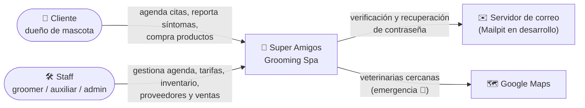
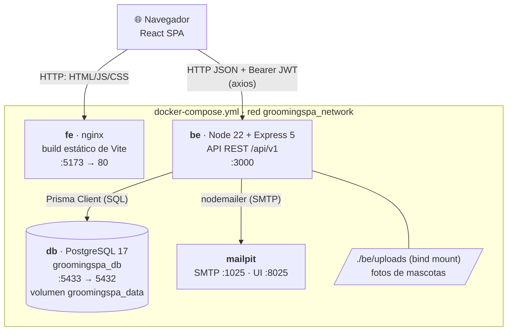
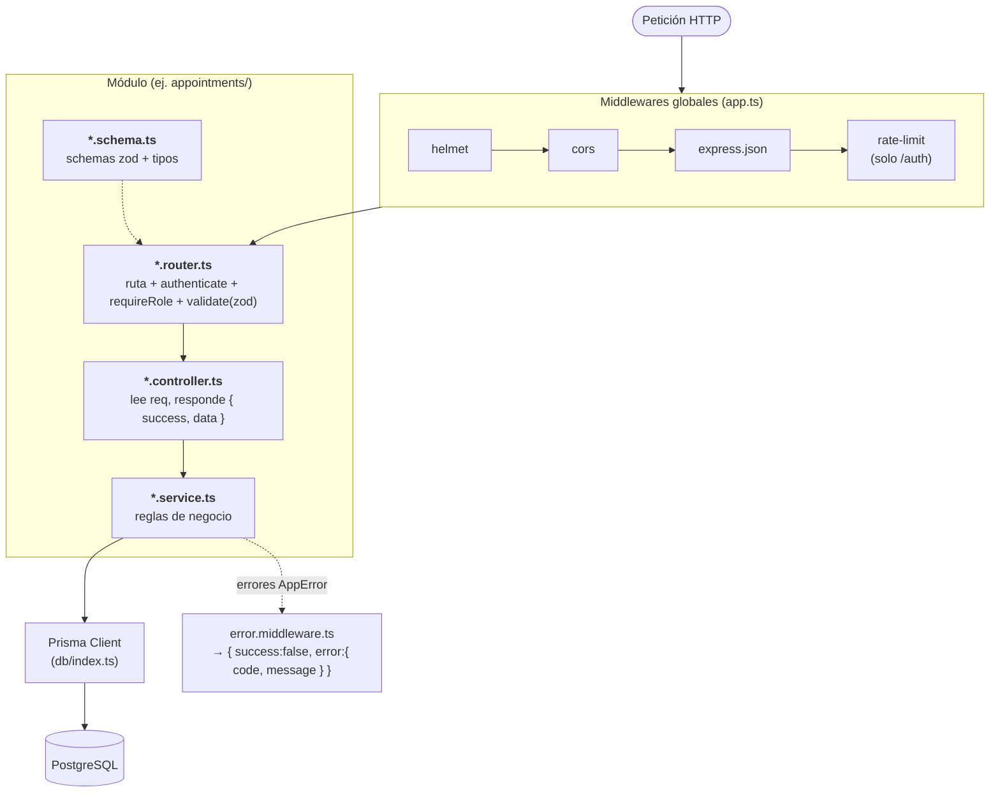
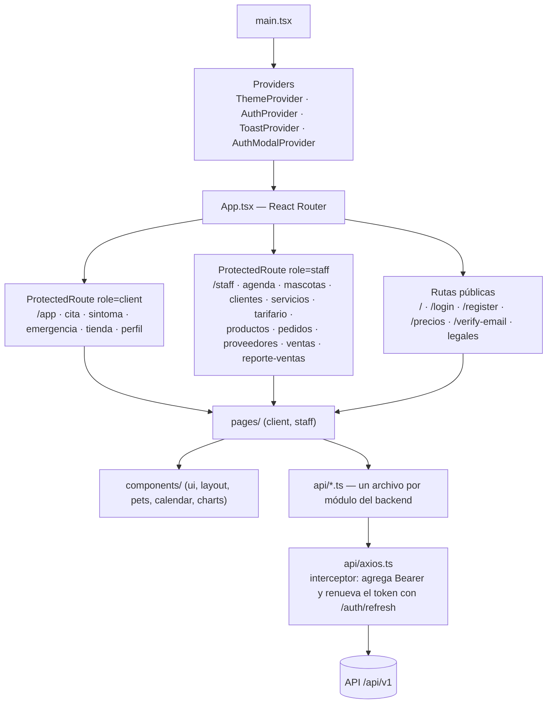
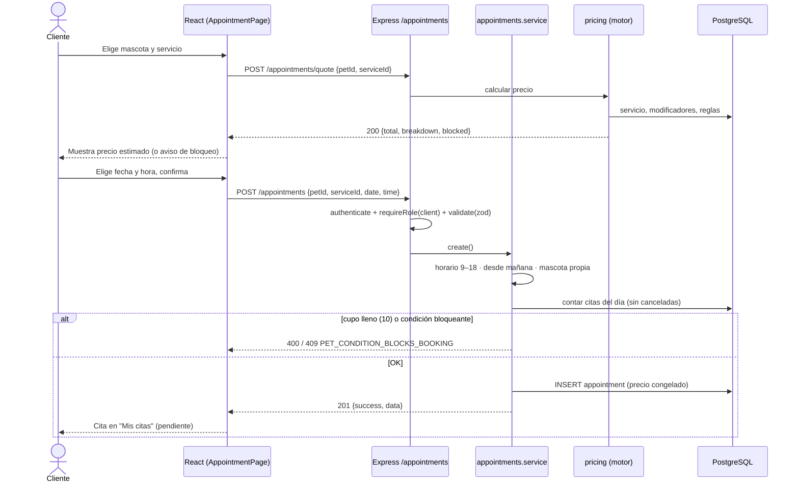
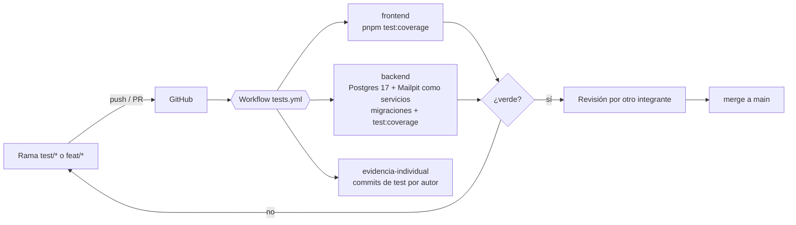

# Arquitectura del sistema — Super Amigos Grooming Spa

<!--
  ¿Qué? Diagramas y descripción de la arquitectura de GroomingSpa: contexto, contenedores,
  capas del backend y del frontend, despliegue, integración continua y un flujo de punta a punta.
  ¿Para qué? Evidenciar cómo se aplican los patrones vistos en la formación (cliente-servidor,
  API REST, arquitectura en capas, separación por módulos, contenedores) en ESTE proyecto.
  ¿Impacto? Reemplaza la versión heredada de la plantilla ("NN Auth"). Los diagramas están en
  Mermaid: GitHub los dibuja automáticamente al abrir este archivo.
-->

## 1. Visión general

GroomingSpa es una aplicación **cliente-servidor** de tres niveles:

| Nivel | Tecnología | Responsabilidad |
|---|---|---|
| Presentación | React 19 + Vite + TypeScript + TailwindCSS (SPA) | Pantallas del cliente (semáforo, tienda, perfil) y del staff (agenda, inventario, ventas) |
| Lógica de negocio | Node.js 22 + Express 5 + TypeScript (API REST `/api/v1`) | Autenticación JWT, reglas de citas, motor de precios, inventario |
| Datos | PostgreSQL 17 + Prisma ORM | 22 tablas, migraciones versionadas |

Servicios de apoyo: **Mailpit** (SMTP de desarrollo para verificación de correo y recuperación de
contraseña) y **Google Maps** (veterinarias cercanas en la pantalla de emergencia).

## 2. Diagrama de contexto

## 3. Diagrama de contenedores (despliegue con Docker Compose)

> El frontend se sirve como archivos estáticos; el navegador llama **directamente** al API usando
> `VITE_API_BASE_URL`. El backend solo acepta peticiones del origen configurado en `FRONTEND_URL` (CORS).

## 4. Arquitectura del backend — capas y módulos

Patrón **en capas por módulo** (*modular monolith*): cada dominio vive en
`be/src/modules/<modulo>/` con los mismos 4 archivos.

| Capa | Responsabilidad | No debe |
|---|---|---|
| Router | Declarar ruta, autenticación, rol y validación | Tener lógica de negocio |
| Controller | Traducir HTTP ↔ servicio, elegir código de estado | Acceder a la BD |
| Service | Reglas de negocio (horario, cupo, precio, stock) | Conocer `req`/`res` |
| Prisma | Acceso a datos tipado | — |

**Módulos (14)**: `auth`, `users`, `staff`, `pets`, `services`, `pricing`, `appointments`,
`symptom-reports`, `emergency-info`, `products`, `orders`, `suppliers`, `supplier-orders`, `sales`.

**Transversales** (`be/src/middlewares`, `be/src/utils`): `auth.middleware` (JWT + rol),
`validate.middleware` (zod), `upload.middleware` (fotos con multer), `error.middleware`,
`audit-log` (eventos de seguridad), `email` (nodemailer), `security` (bcrypt + JWT),
`config.ts` (valida variables de entorno al arrancar; si falta una, el proceso termina con mensaje claro).

## 5. Arquitectura del frontend

- **Estado de sesión**: `AuthContext` guarda el usuario y los tokens; `ProtectedRoute` redirige a
  `/login` sin sesión, y a `/app` si un cliente intenta entrar a una ruta de staff.
- **Tipos compartidos**: `fe/src/types/*` replica los DTO del backend (un archivo por módulo).
- **Tema claro/oscuro**: `ThemeProvider` con variables de Tailwind.

## 6. Flujo de punta a punta — agendar una cita (🟢 semáforo)

## 7. Integración continua

## 8. Patrones y decisiones técnicas

| Decisión | Por qué |
|---|---|
| API REST versionada (`/api/v1`) | Contrato estable entre FE y BE; permite evolucionar sin romper clientes |
| Arquitectura en capas por módulo | Cada dominio es independiente y fácil de probar (el service se prueba sin HTTP) |
| JWT stateless (access 15 min + refresh 7 días) | No requiere sesiones en servidor; el refresh evita pedir login seguido |
| Prisma ORM | Tipos generados desde el schema, migraciones versionadas, consultas parametrizadas (evita SQL injection). Se migró desde Drizzle por un CVE de SQL injection |
| Validación con zod en el borde | Ningún dato inválido llega al service; errores 422 legibles para el formulario |
| Precio congelado en la cita (`priceBreakdown`) | Si el staff cambia el tarifario, las citas ya agendadas conservan su precio |
| Docker Compose | El proyecto completo se levanta igual en cualquier computador |
| BD de pruebas separada | Los tests vacían tablas: nunca deben tocar la BD de desarrollo |

## 9. Consideraciones para producción

- Cambiar `JWT_ACCESS_SECRET`/`JWT_REFRESH_SECRET` y credenciales de BD (los de `.env.example` son de ejemplo).
- Reemplazar Mailpit por un SMTP real (`MAIL_HOST`, `MAIL_PORT`, `MAIL_FROM`).
- Servir FE y BE detrás de HTTPS; ajustar `FRONTEND_URL` y `VITE_API_BASE_URL` al dominio real.
- Guardar las fotos de mascotas en almacenamiento persistente (volumen o bucket), no dentro de la imagen.
