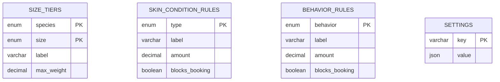

# Modelo de datos — Super Amigos Grooming Spa (MER y MR)

<!--
  ¿Qué? Modelo Entidad-Relación (MER), Modelo Relacional (MR) y diccionario de datos de GroomingSpa.
  ¿Para qué? Documentar las 22 tablas reales de be/prisma/schema.prisma, sus llaves y relaciones.
  ¿Impacto? Reemplaza la versión heredada de la plantilla ("NN Auth"), que solo describía users.
  Cualquier cambio de esquema se hace con una migración de Prisma y se refleja aquí.
-->

| Campo | Valor |
|---|---|
| Motor | PostgreSQL 17 |
| ORM / migraciones | Prisma 7 (`be/prisma/schema.prisma`, `be/prisma/migrations/` — 9 migraciones) |
| Llaves primarias | UUID (`gen_random_uuid()`), excepto tablas de reglas (llave natural) |
| Convención | Modelos en PascalCase (Prisma) → tablas y columnas en snake_case (`@@map`/`@map`) |

---

## 1. Modelo Entidad-Relación (MER)

Diagrama en notación *crow's foot* (pata de gallo). `||` = exactamente uno, `o|` = cero o uno,
`o{` = cero o muchos, `|{` = uno o muchos.

```mermaid
erDiagram
    USERS ||--o{ PETS : "es dueño de"
    USERS ||--o{ APPOINTMENTS : "agenda"
    USERS ||--o{ SYMPTOM_REPORTS : "reporta"
    USERS ||--o{ ORDERS : "realiza"
    USERS ||--o{ PASSWORD_RESET_TOKENS : "solicita"
    USERS ||--o{ EMAIL_VERIFICATION_TOKENS : "recibe"
    USERS |o--o{ SALES : "compra (opcional)"
    USERS ||--o{ SALES : "registra (staff)"
    USERS |o--o{ PRODUCTS : "crea / actualiza"

    PETS ||--o{ PET_SKIN_CONDITIONS : "presenta"
    PETS ||--o{ APPOINTMENTS : "recibe"
    PETS ||--o{ SYMPTOM_REPORTS : "tiene"

    SERVICES ||--o{ APPOINTMENTS : "se presta en"
    SERVICES ||--o{ SERVICE_SIZE_MODIFIERS : "recargo por tamaño"
    SERVICES ||--o{ SERVICE_COAT_MODIFIERS : "recargo por pelo"

    PRODUCTS ||--o{ ORDER_ITEMS : "aparece en"
    PRODUCTS ||--o{ SALE_ITEMS : "aparece en"
    PRODUCTS ||--o{ SUPPLIER_ORDER_ITEMS : "se reabastece en"

    ORDERS ||--|{ ORDER_ITEMS : "contiene"
    SALES ||--|{ SALE_ITEMS : "contiene"
    SUPPLIERS ||--o{ SUPPLIER_ORDERS : "recibe"
    SUPPLIER_ORDERS ||--|{ SUPPLIER_ORDER_ITEMS : "contiene"

    USERS {
        uuid id PK
        varchar document_id UK
        varchar first_name
        varchar last_name
        varchar phone
        varchar email UK
        varchar hashed_password
        enum role "client | staff"
        boolean is_email_verified
    }
    PETS {
        uuid id PK
        uuid client_id FK
        varchar name
        enum species "canina | felina"
        varchar breed
        int age
        decimal weight
        enum size
        enum coat_type
        enum behavior
        varchar pathology
        varchar photo_url
    }
    PET_SKIN_CONDITIONS {
        uuid id PK
        uuid pet_id FK
        enum type "UK con pet_id"
        varchar note
    }
    SERVICES {
        uuid id PK
        varchar name
        decimal price
        int duration_minutes
        boolean active
    }
    SERVICE_SIZE_MODIFIERS {
        uuid id PK
        uuid service_id FK
        enum species
        enum size
        decimal amount
    }
    SERVICE_COAT_MODIFIERS {
        uuid id PK
        uuid service_id FK
        enum species
        enum coat_type
        decimal amount
    }
    APPOINTMENTS {
        uuid id PK
        uuid client_id FK
        uuid pet_id FK
        uuid service_id FK
        date date
        varchar time
        enum status
        decimal total_price
        json price_breakdown
    }
    SYMPTOM_REPORTS {
        uuid id PK
        uuid client_id FK
        uuid pet_id FK
        text symptom
        int days_with_symptom
        enum status
        text recommendation
    }
    PRODUCTS {
        uuid id PK
        varchar name
        decimal price
        int stock
        varchar category
        boolean active
        uuid created_by_id FK
        uuid updated_by_id FK
    }
    ORDERS {
        uuid id PK
        uuid client_id FK
        enum status
        enum payment_status
        decimal total
    }
    ORDER_ITEMS {
        uuid id PK
        uuid order_id FK
        uuid product_id FK
        int quantity
        decimal unit_price
    }
    SALES {
        uuid id PK
        uuid client_id FK "nullable"
        varchar client_name
        uuid registered_by_id FK
        decimal total
    }
    SALE_ITEMS {
        uuid id PK
        uuid sale_id FK
        uuid product_id FK
        int quantity
        decimal unit_price
    }
    SUPPLIERS {
        uuid id PK
        varchar name
        varchar contact_name
        varchar phone
        varchar email
        boolean active
    }
    SUPPLIER_ORDERS {
        uuid id PK
        uuid supplier_id FK
        enum status "ordered | received"
        date expected_date
        date received_date
    }
    SUPPLIER_ORDER_ITEMS {
        uuid id PK
        uuid supplier_order_id FK
        uuid product_id FK
        int quantity
        decimal unit_cost
    }
    PASSWORD_RESET_TOKENS {
        uuid id PK
        uuid user_id FK
        varchar token UK
        timestamp expires_at
        boolean used
    }
    EMAIL_VERIFICATION_TOKENS {
        uuid id PK
        uuid user_id FK
        varchar token UK
        timestamp expires_at
        boolean used
    }
```

### Tablas de configuración (sin relaciones)

Estas tablas alimentan el **motor de precios** (tramos de peso por especie, recargos y bloqueos) y
la configuración general (`settings` guarda hoy la información de emergencia: búsqueda del mapa y teléfonos).

---

## 2. Modelo Relacional (MR)

Notación: **PK** subrayada como `PK`, llaves foráneas como `FK → tabla(columna)`.

| Tabla | Columnas | Llaves y restricciones |
|---|---|---|
| **users** | id, document_id, first_name, last_name, phone, email, hashed_password, role, is_email_verified, created_at, updated_at | PK(id) · UK(email) · UK(document_id) |
| **email_verification_tokens** | id, user_id, token, expires_at, used, created_at | PK(id) · FK user_id → users(id) ON DELETE CASCADE · UK(token) |
| **password_reset_tokens** | id, user_id, token, expires_at, used, created_at | PK(id) · FK user_id → users(id) ON DELETE CASCADE · UK(token) |
| **pets** | id, client_id, name, species, breed, gender, age, weight, color, size, coat_type, behavior, pathology, photo_url, created_at | PK(id) · FK client_id → users(id) ON DELETE CASCADE |
| **pet_skin_conditions** | id, pet_id, type, note, created_at | PK(id) · FK pet_id → pets(id) ON DELETE CASCADE · **UK(pet_id, type)** |
| **services** | id, name, description, price, duration_minutes, active, created_at | PK(id) |
| **service_size_modifiers** | id, service_id, species, size, amount | PK(id) · FK service_id → services(id) ON DELETE CASCADE · UK(service_id, species, size) |
| **service_coat_modifiers** | id, service_id, species, coat_type, amount | PK(id) · FK service_id → services(id) ON DELETE CASCADE · UK(service_id, species, coat_type) |
| **size_tiers** | species, size, label, max_weight | PK(species, size) |
| **skin_condition_rules** | type, label, amount, blocks_booking | PK(type) |
| **behavior_rules** | behavior, label, amount, blocks_booking | PK(behavior) |
| **appointments** | id, client_id, pet_id, service_id, date, time, status, notes, total_price, price_breakdown, created_at, updated_at | PK(id) · FK client_id → users(id) CASCADE · FK pet_id → pets(id) CASCADE · FK service_id → services(id) |
| **symptom_reports** | id, client_id, pet_id, symptom, days_with_symptom, notes, status, recommendation, reviewed_at, created_at | PK(id) · FK client_id → users(id) CASCADE · FK pet_id → pets(id) CASCADE |
| **products** | id, name, description, price, stock, category, active, created_by_id, updated_by_id, created_at, updated_at | PK(id) · FK created_by_id → users(id) · FK updated_by_id → users(id) (ambas opcionales) |
| **orders** | id, client_id, status, payment_status, total, created_at, updated_at | PK(id) · FK client_id → users(id) CASCADE |
| **order_items** | id, order_id, product_id, quantity, unit_price | PK(id) · FK order_id → orders(id) CASCADE · FK product_id → products(id) |
| **suppliers** | id, name, contact_name, phone, email, address, active, created_at | PK(id) |
| **supplier_orders** | id, supplier_id, status, expected_date, received_date, created_at | PK(id) · FK supplier_id → suppliers(id) |
| **supplier_order_items** | id, supplier_order_id, product_id, quantity, unit_cost | PK(id) · FK supplier_order_id → supplier_orders(id) CASCADE · FK product_id → products(id) |
| **sales** | id, client_id, client_name, registered_by_id, status, payment_status, total, created_at | PK(id) · FK client_id → users(id) (nullable) · FK registered_by_id → users(id) |
| **sale_items** | id, sale_id, product_id, quantity, unit_price | PK(id) · FK sale_id → sales(id) CASCADE · FK product_id → products(id) |
| **settings** | key, value, updated_at | PK(key) |

### Normalización

- **1FN**: todos los atributos son atómicos; las condiciones de piel de una mascota (multivaluadas)
  se separaron en `pet_skin_conditions`.
- **2FN**: las tablas de detalle (`order_items`, `sale_items`, `supplier_order_items`) usan PK
  propia y guardan solo lo que depende de la línea (cantidad, precio unitario).
- **3FN**: los recargos no se repiten en cada mascota o cita: viven en tablas de reglas
  (`skin_condition_rules`, `behavior_rules`, `size_tiers`, modificadores por servicio).
- **Desnormalización intencional**: `appointments.total_price` / `price_breakdown` y
  `*_items.unit_price` guardan el precio **en el momento** de la operación, para que un cambio
  posterior del tarifario no altere el histórico.

## 3. Dominios (enums)

| Enum | Valores |
|---|---|
| `UserRole` | client, staff |
| `PetSpecies` | canina, felina |
| `PetSize` | pequeno, mediano, grande, gigante |
| `CoatType` | corto, largo |
| `PetBehavior` | tranquilo, nervioso, agresivo |
| `SkinConditionType` | pulgas, garrapatas, piel_irritada, alergia, piel_sensible, nudos, hongos, sarna, heridas, infeccion |
| `AppointmentStatus` | pending, confirmed, completed, cancelled |
| `SymptomReportStatus` | pending, reviewed |
| `OrderStatus` | pending, completed, cancelled |
| `PaymentStatus` | unpaid, paid |
| `SupplierOrderStatus` | ordered, received |

## 4. Reglas de borrado (integridad referencial)

| Si se borra… | Se borran en cascada | Se impide el borrado si existen |
|---|---|---|
| Un usuario | sus tokens, mascotas, citas, reportes y pedidos (en sus compras de mostrador y productos creados el vínculo queda en NULL) | ventas registradas por él como staff |
| Una mascota | sus condiciones de piel, citas y reportes | — |
| Un servicio | sus modificadores | citas que lo usan |
| Un producto | — | líneas de pedido, venta o pedido a proveedor |
| Un proveedor | — | pedidos a ese proveedor |
