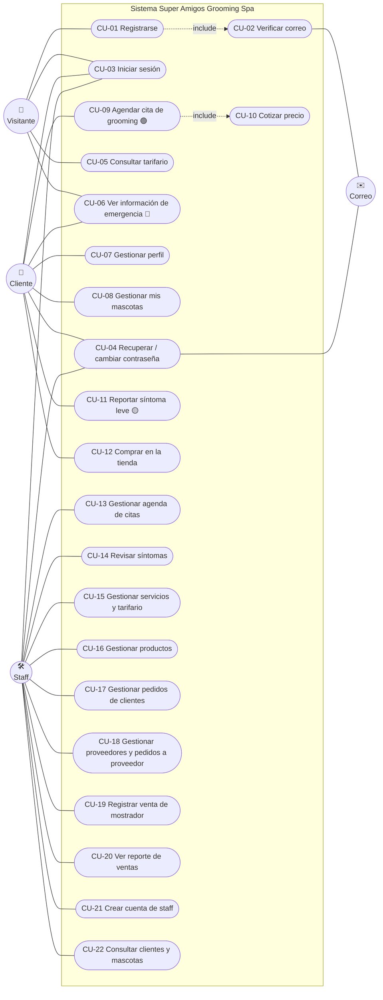
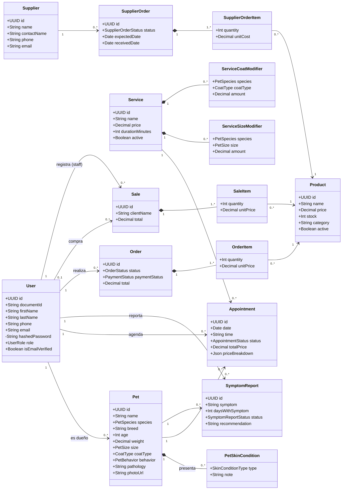
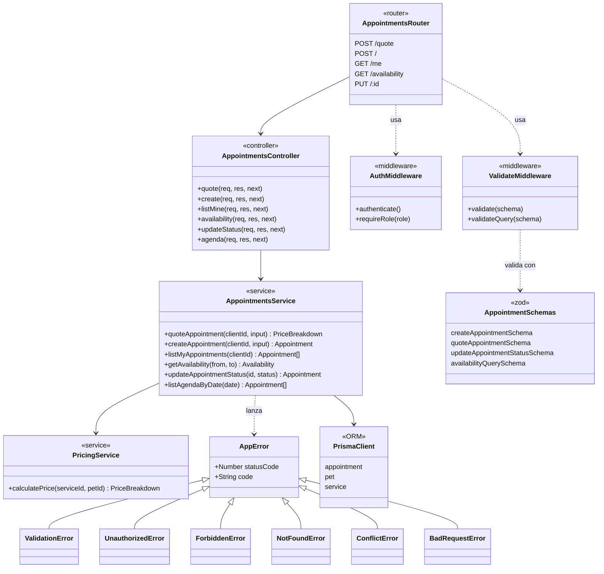
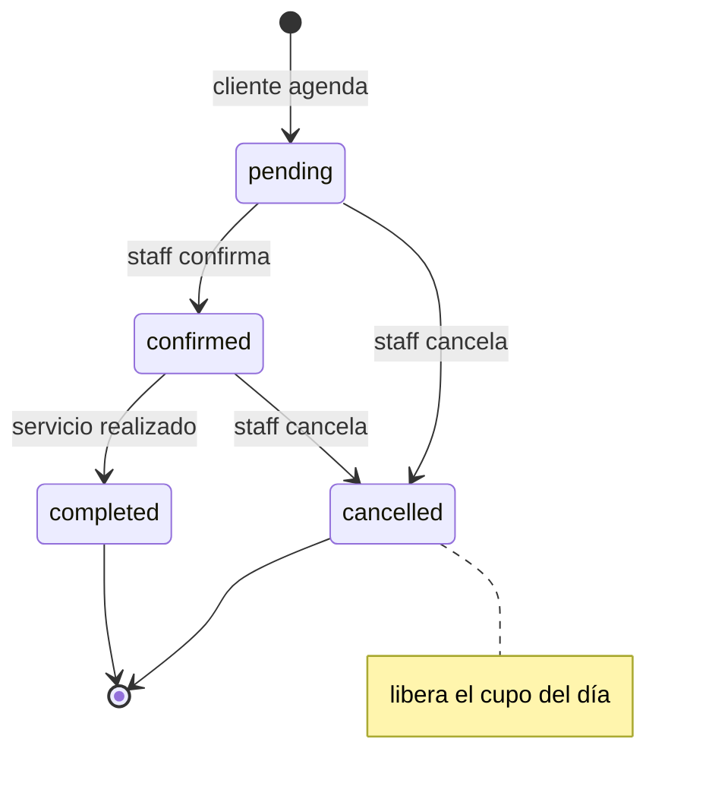
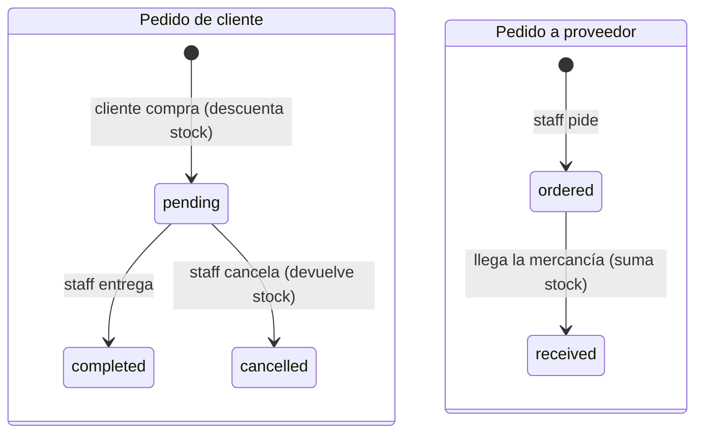

# Diagramas UML — Super Amigos Grooming Spa

<!--
  ¿Qué? Diagrama de casos de uso, especificación de los casos principales, diagrama de clases
  del dominio, diagrama de clases de la arquitectura del backend y diagramas de estado.
  ¿Para qué? Completar la documentación de análisis y diseño junto con los RFs/HUs
  (docs/requisitos/), el MER/MR (database-schema.md) y la arquitectura (architecture.md).
  ¿Impacto? Los diagramas están en Mermaid: GitHub los dibuja al abrir el archivo.
-->

## 1. Actores

| Actor | Descripción |
|---|---|
| **Visitante** | Persona sin sesión: ve la landing, el tarifario y la información de emergencia |
| **Cliente** | Dueño de mascota registrado y con correo verificado |
| **Staff** | Personal del spa (groomer, auxiliar en veterinaria, administración) |
| **Servidor de correo** | Sistema externo que entrega los correos de verificación y recuperación |

## 2. Diagrama de casos de uso

> Mermaid no tiene diagrama de casos de uso nativo; se representa con actores (círculos) y casos
> de uso (óvalos) dentro del límite del sistema. Las flechas punteadas son `<<include>>`.

| CU | Actor | RF / HU |
|---|---|---|
| CU-01, CU-02 | Visitante, Correo | RF-001, RF-003 |
| CU-03, CU-04 | Cliente, Staff | RF-002, RF-004, RF-005, RF-006 |
| CU-05 | Visitante | RF-014 |
| CU-06 | Visitante, Cliente | RF-011 |
| CU-07 | Cliente | RF-007 |
| CU-08 | Cliente | RF-012, RF-013 |
| CU-09, CU-10 | Cliente | RF-009, RF-014 |
| CU-11 | Cliente | RF-010 |
| CU-12 | Cliente | RF-015, RF-016 |
| CU-13 | Staff | RF-017 |
| CU-14 | Staff | RF-018 |
| CU-15 | Staff | RF-014 |
| CU-16 | Staff | RF-015 |
| CU-17 | Staff | RF-019 |
| CU-18 | Staff | RF-020, RF-021 |
| CU-19 | Staff | RF-023 |
| CU-20 | Staff | RF-022 |
| CU-21 | Staff | RF-008 |
| CU-22 | Staff | RF-012, RF-013 |

## 3. Especificación de casos de uso principales

### CU-09 — Agendar cita de grooming 🟢

| Campo | Detalle |
|---|---|
| Actor | Cliente |
| Precondición | Sesión iniciada, correo verificado y al menos una mascota registrada |
| Postcondición | Cita creada en estado `pending` con el precio congelado |
| Incluye | CU-10 Cotizar precio |

**Flujo principal**
1. El cliente entra a `/app/cita` (opción verde del semáforo).
2. Elige una de sus mascotas y un servicio.
3. El sistema cotiza el precio (base + tamaño + pelo + piel + comportamiento) y lo muestra.
4. El cliente elige fecha y hora y confirma.
5. El sistema valida las reglas y guarda la cita.
6. La cita aparece en "Mis citas" como pendiente.

**Flujos alternos**
- 3a. La mascota tiene una condición que bloquea (sarna, hongos, agresividad): el sistema muestra
  el aviso y sugiere reportar síntoma (CU-11). No se puede agendar (409).
- 5a. Hora fuera de 9:00–18:00, o fecha anterior a mañana: error 400 con mensaje.
- 5b. El día ya tiene 10 citas activas: error 400 "cupo lleno".

### CU-11 — Reportar síntoma leve 🟡

| Campo | Detalle |
|---|---|
| Actor | Cliente (reporta) · Staff (revisa en CU-14) |
| Precondición | Sesión iniciada y mascota propia |
| Postcondición | Reporte `pending`; al revisarlo, `reviewed` con recomendación |

1. El cliente describe el síntoma (≥ 3 caracteres) y los días que lleva.
2. El sistema guarda el reporte como pendiente.
3. La auxiliar lo revisa y escribe una recomendación (sin diagnóstico ni tratamiento).
4. El cliente ve la recomendación en su historial.

### CU-19 — Registrar venta de mostrador

| Campo | Detalle |
|---|---|
| Actor | Staff |
| Postcondición | Venta pagada registrada y stock descontado |

1. El staff agrega productos y cantidades.
2. Opcionalmente asocia un cliente registrado **o** escribe un nombre (no ambos).
3. El sistema verifica stock, descuenta inventario y guarda la venta con el precio del momento.
- 3a. Stock insuficiente: error 409, no se guarda nada.

---

## 4. Diagrama de clases — dominio

`*--` = composición (el detalle no existe sin su dueño y se borra en cascada) · `-->` = asociación.

## 5. Diagrama de clases — arquitectura del backend (módulo Citas)

Todos los módulos siguen el mismo patrón; se muestra `appointments` como ejemplo.

## 6. Diagramas de estado

### Cita

### Pedido de cliente y pedido a proveedor

